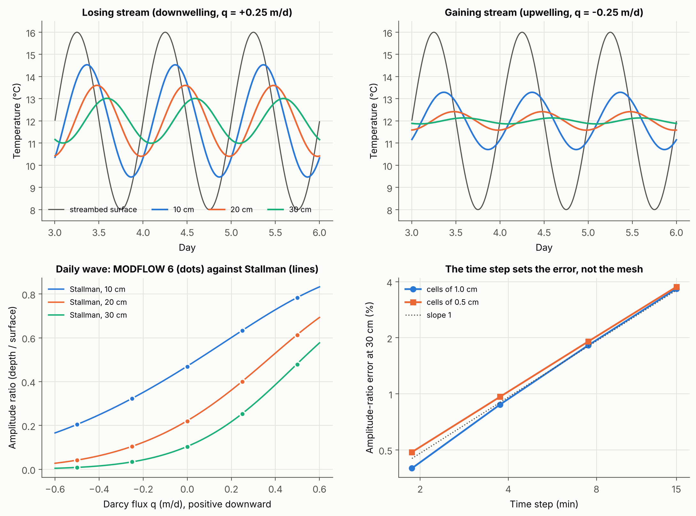
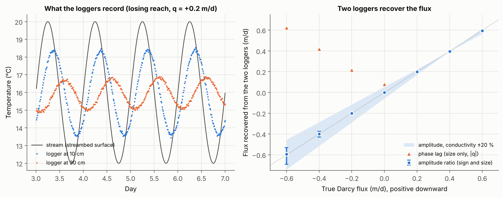
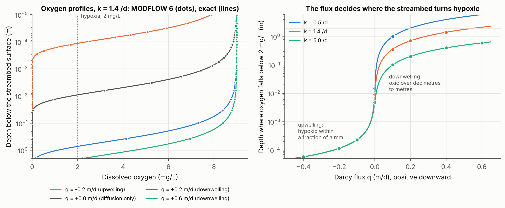

# streambed-heat-oxygen

**Water, heat and oxygen exchange between a stream and its bed in MODFLOW 6: the groundwater energy transport model verified against Stallman's solution, the flux recovered from two buried temperature loggers, and the depth where the streambed runs out of oxygen.**

Whether a stream loses water to its bed or gains it from the aquifer decides much of what happens in the hyporheic zone. Downwelling stream water carries heat and oxygen into the sediment; upwelling groundwater pushes them back. The flux itself is rarely measured, but its fingerprint is easy to record: the daily temperature wave of the stream fades and lags with depth, faster or slower depending on the flux. And the same flux sets how deep oxygen reaches before microbes consume it, which is where denitrification and other anaerobic processes can start.

This repository builds that chain with MODFLOW 6 and FloPy, using the groundwater energy transport model (GWE) of Morway et al. (2025) for heat and the groundwater transport model (GWT) for oxygen. Each step is checked against an exact solution before it is used.

| Script | What it does | Verified against |
|---|---|---|
| `01_heat_verification.py` | Vertical streambed column (GWF + GWE) under a daily stream temperature cycle, for fluxes from -0.5 m/d (upwelling) to +0.5 m/d (downwelling) | Stallman (1965) solution for amplitude and phase; convergence in time and space |
| `02_flux_from_temperature.py` | MODFLOW 6 plays the field: two loggers at 10 and 30 cm record with noise; the flux is recovered from the amplitude ratio and the phase lag (Hatch et al., 2006; Keery et al., 2007) | True flux of each run; 200 noise realisations; thermal conductivity misjudged by ±20 % |
| `03_oxygen_in_the_streambed.py` | Dissolved oxygen in the bed (GWF + GWT) with first-order consumption; depth where it falls below 2 mg/L; fed with the fluxes recovered from the loggers | Exact steady profile C₀ exp(λz) for 24 combinations of flux and consumption rate |

Library module: `column.py` (MODFLOW 6 column models, analytical solutions, sinusoid fitting).

## Results

### 1. MODFLOW 6 GWE reproduces Stallman's solution, and the time step sets the error

For the five fluxes and three sensor depths, the amplitude ratio of the daily wave computed by MODFLOW 6 matches the analytical solution within 1.1 %, and the phase lag within 4.2 minutes, with 3.75-minute time steps and 1 cm cells.

The error comes from the time step, not from the mesh. MODFLOW 6 solves the storage term with implicit Euler, which damps a periodic signal. At 30 cm under a flux of +0.25 m/d, the amplitude ratio is 3.7 % too low with 15-minute steps, 1.8 % with 7.5 minutes, 0.9 % with 3.75 minutes and 0.4 % with 1.9 minutes: first order in time. Halving the cells from 1 cm to 0.5 cm changes almost nothing. A model run at the 15-minute interval of most loggers therefore underestimates the amplitude by a few percent, which matters when the amplitude is used to infer the flux.



### 2. Two loggers recover the flux, the amplitude ratio better than the phase lag

Stream at 16 ± 4 °C per day, groundwater at 11 °C, loggers at 10 and 30 cm with 0.05 °C of noise, four days analysed:

| True flux (m/d) | Amplitude ratio method (m/d), median [5 to 95 %] | Same, conductivity -20 % / +20 % | Phase lag method, \|q\| (m/d) [5 to 95 %] |
|---|---|---|---|
| -0.60 | -0.594 [-0.691, -0.529] | -0.454 / -0.740 | 0.623 [0.196, 0.968] |
| -0.40 | -0.400 [-0.428, -0.374] | -0.286 / -0.515 | 0.418 [0.274, 0.527] |
| -0.20 | -0.201 [-0.212, -0.192] | -0.116 / -0.287 | 0.218 [0.134, 0.280] |
| 0.00 | +0.001 [-0.004, +0.006] | +0.055 / -0.057 | 0.081 [0.000, 0.141] |
| +0.20 | +0.199 [+0.195, +0.202] | +0.223 / +0.170 | 0.212 [0.197, 0.227] |
| +0.40 | +0.396 [+0.393, +0.399] | +0.392 / +0.394 | 0.406 [0.400, 0.411] |
| +0.60 | +0.594 [+0.590, +0.596] | +0.566 / +0.615 | 0.604 [0.601, 0.607] |

What the numbers show:

- **Downwelling is easy.** The daily wave reaches 30 cm with a large amplitude, so noise hardly matters and both methods recover the flux within 1 to 2 %.
- **Upwelling is hard.** Rising groundwater erases the wave before 30 cm (amplitude ratio 0.03 at 30 cm for -0.25 m/d in script 01), so noise and the thermal conductivity dominate: a ±20 % error on the conductivity moves the estimate of -0.6 m/d to between -0.45 and -0.74 m/d. In gaining reaches, loggers should sit closer to the surface.
- **The phase lag gives only the size of the flux**, not its direction, and becomes unreliable under upwelling; the amplitude ratio gives both.



### 3. The flux decides where the streambed turns hypoxic

MODFLOW 6 GWT reproduces the exact oxygen profiles within 0.08 mg/L for all 24 runs, including profiles that fall to zero within a tenth of a millimetre (geometric grid, 10 µm at the surface).

| Darcy flux (m/d) | Depth where oxygen < 2 mg/L, k = 0.5 /d | k = 1.4 /d | k = 5 /d |
|---|---|---|---|
| -0.2 (upwelling) | 0.11 mm | 0.11 mm | 0.11 mm |
| 0 (diffusion only) | 15 mm | 9 mm | 5 mm |
| +0.1 (downwelling) | 1.0 m | 0.36 m | 0.10 m |
| +0.2 | 2.0 m | 0.72 m | 0.20 m |
| +0.6 | 6.0 m | 2.1 m | 0.60 m |

- **Upwelling keeps the bed hypoxic just below its surface**, whatever the consumption rate: oxygen can only enter against the flow by diffusion.
- **Downwelling pushes the oxic zone down by decimetres to metres.** When advection dominates, hypoxia starts where the travel time τ times the consumption rate k reaches ln(9/2) ≈ 1.5, a Damköhler number of order one, as in the framework of Zarnetske et al. (2012).
- **From two loggers to the hypoxic depth.** With k = 1.4 /d and a true flux of +0.2 m/d, the hypoxic depth is 71.6 cm; from the flux recovered by the loggers it is 71.2 cm, and 61 to 80 cm if the thermal conductivity is off by ±20 %. Near zero flux, the hypoxic depth switches from millimetres to decimetres over a few centimetres per day of flux: this transition zone is where the flux has to be known best.



## Methods

**Flow.** One column of cells from the streambed surface to 2 m, uniform hydraulic conductivity, constant heads at the top and bottom cells that give a uniform Darcy flux q (positive downward). Depths are measured from the centre of the top cell, where the stream boundary acts.

**Heat** (GWE), z downward, with the effective thermal diffusivity κ = λ/(ρc)_b and the thermal front velocity v = q (ρc)_w/(ρc)_b:

$$\frac{\partial T}{\partial t} = \kappa \frac{\partial^2 T}{\partial z^2} - v \frac{\partial T}{\partial z}$$

For a sinusoidal surface temperature of angular frequency ω, the periodic part is A exp(Re(λ) z) cos(ωt + Im(λ) z), with λ the decaying root of κλ² - vλ - iω = 0 (Stallman, 1965). The amplitude ratio between two depths Δz apart is exp(Re(λ) Δz) and the phase lag -Im(λ) Δz / ω. Hatch et al. (2006) and Keery et al. (2007) invert these two relations for v; script 02 does it with a root finder. MODFLOW's bulk conductivity is the porosity-weighted mean of the water and solid conductivities; the solid value is set so that the bulk value is 1.8 W/m/K.

**Oxygen** (GWT), first-order consumption k, pore velocity v = q/n, diffusion coefficient D in the pore water. The steady profile is C₀ exp(λz) with λ = (v - √(v² + 4Dk)) / (2D). Under downwelling the bottom is a free outflow; under upwelling oxygen-free groundwater enters at the bottom.

**Signal analysis.** Each temperature record is fitted by least squares with a constant, a linear drift and a daily sine and cosine; the amplitude and phase come from the sine and cosine terms.

## Run it

```bash
python -m venv .venv
source .venv/bin/activate              # Windows: .venv\Scripts\activate
pip install -r requirements.txt
get-modflow :flopy                     # installs mf6 (comes with FloPy); or set MF6_EXE to your mf6
python 01_heat_verification.py         # about 7 min (convergence study included)
python 02_flux_from_temperature.py     # about 4 min
python 03_oxygen_in_the_streambed.py   # under 1 min, uses the results of script 02
```

Tested with MODFLOW 6.7.0 and FloPy 3.12.

## Assumptions

- One-dimensional vertical flow and transport in a homogeneous, saturated sandy bed; steady flux; no thermal or mechanical dispersion (both are small next to conduction and diffusion for these fluxes, and leaving them out keeps the analytical checks exact).
- Sediment: porosity 0.30, quartz grains (2650 kg/m³, 840 J/kg/K), bulk thermal conductivity 1.8 W/m/K, within the ranges compiled by Stonestrom and Constantz (2003).
- Stream temperature: a pure daily sinusoid; field records add weather and longer cycles, which the drift term only partly absorbs.
- Oxygen: 9 mg/L in the stream (about saturation at 20 °C), none in upwelling groundwater. First-order consumption at 0.5 and 1.4 /d, the range measured in flume dunes with leaf litter by Reeder et al. (2018), and 5 /d, the field value at 20 °C used by Tonina et al. (2015). Molecular diffusion of oxygen in water about 2 × 10⁻⁹ m²/s near 20 °C, divided by the tortuosity factor 1 - ln(n²) of Boudreau (1996). Hypoxia at 2 mg/L.

## Next steps

1. Replace the vertical column by a two-dimensional bed with dunes, where the exchange is driven by the pressure variations of the stream over the bedforms, and by the turbulent exchange across the bed surface (Chen et al., 2024).
2. Add nitrate and denitrification below the hypoxic depth, to turn the oxic-anoxic switch into a nitrate removal rate.
3. Use real logger records (for example from a losing urban stream) and invert the flux continuously with a moving window, with MODFLOW 6 as the forward model.
4. Train a fast surrogate on MODFLOW 6 runs to map temperature records to flux and hypoxic depth along a whole reach.

## References

- Bakker, M., Post, V., Langevin, C. D., Hughes, J. D., White, J. T., Starn, J. J., and Fienen, M. N. (2016). Scripting MODFLOW model development using Python and FloPy. *Groundwater*, 54(5), 733-739.
- Boudreau, B. P. (1996). The diffusive tortuosity of fine-grained unlithified sediments. *Geochimica et Cosmochimica Acta*, 60(16), 3139-3142.
- Chen, C.-Y., Fytanidis, D. K., and García, M. H. (2024). A unifying model for turbulent hyporheic mass flux under a wide range of near-bed hydrodynamic conditions. *Geophysical Research Letters*, 51(6), e2023GL105807.
- Hatch, C. E., Fisher, A. T., Revenaugh, J. S., Constantz, J., and Ruehl, C. (2006). Quantifying surface water-groundwater interactions using time series analysis of streambed thermal records: Method development. *Water Resources Research*, 42, W10410.
- Hughes, J. D., Langevin, C. D., and Banta, E. R. (2017). *Documentation for the MODFLOW 6 framework*. U.S. Geological Survey Techniques and Methods 6-A57.
- Keery, J., Binley, A., Crook, N., and Smith, J. W. N. (2007). Temporal and spatial variability of groundwater-surface water fluxes: Development and application of an analytical method using temperature time series. *Journal of Hydrology*, 336, 1-16.
- Morway, E. D., Provost, A. M., Langevin, C. D., Hughes, J. D., Russcher, M. J., Chen, C.-Y., and Lin, Y.-F. (2025). A new groundwater energy transport model for the MODFLOW hydrologic simulator. *Groundwater*, 63(3), 409-421.
- Reeder, W. J., Quick, A. M., Farrell, T. B., Benner, S. G., Feris, K. P., and Tonina, D. (2018). Spatial and temporal dynamics of dissolved oxygen concentrations and bioactivity in the hyporheic zone. *Water Resources Research*, 54, 2112-2128.
- Stallman, R. W. (1965). Steady one-dimensional fluid flow in a semi-infinite porous medium with sinusoidal surface temperature. *Journal of Geophysical Research*, 70(12), 2821-2827.
- Stonestrom, D. A., and Constantz, J. (eds.) (2003). *Heat as a Tool for Studying the Movement of Ground Water near Streams*. U.S. Geological Survey Circular 1260.
- Tonina, D., Marzadri, A., and Bellin, A. (2015). Benthic uptake rate due to hyporheic exchange: The effects of streambed morphology for constant and sinusoidally varying nutrient loads. *Water*, 7, 398-419.
- Zarnetske, J. P., Haggerty, R., Wondzell, S. M., Bokil, V. A., and González-Pinzón, R. (2012). Coupled transport and reaction kinetics control the nitrate source-sink function of hyporheic zones. *Water Resources Research*, 48, W11508.

## Author

Abdoul Latif Intchi Roufai · MSc Biogeosciences, University of Lausanne and University of Neuchâtel · [github.com/Lroufai](https://github.com/Lroufai)
